# Capturas de Revisión — `release/1.5.1` (Temporal)

> Carpeta temporal para revisión visual previa al cierre y fusión hacia `main`. Se eliminará antes del merge final.

## Etapa 3 — Fondos, Temáticos Experimentales y "Mi foto" (`390px`)

### Configuraciones > Fondo (Básicos y Escala de grises)
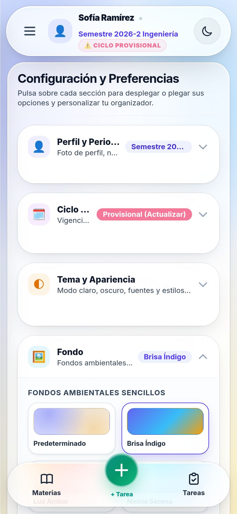

### Configuraciones > Fondo ("Mi foto" + Punto de enfoque + Sliders)
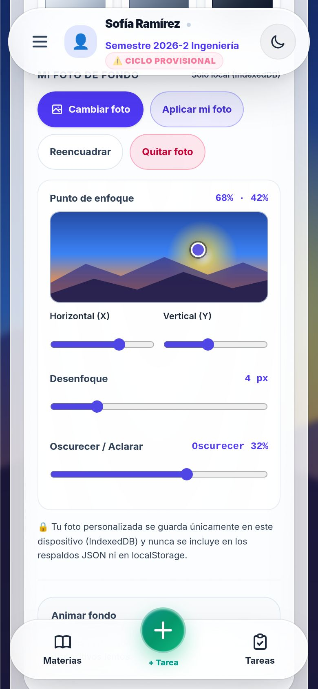

### Brisa Índigo (Notas)
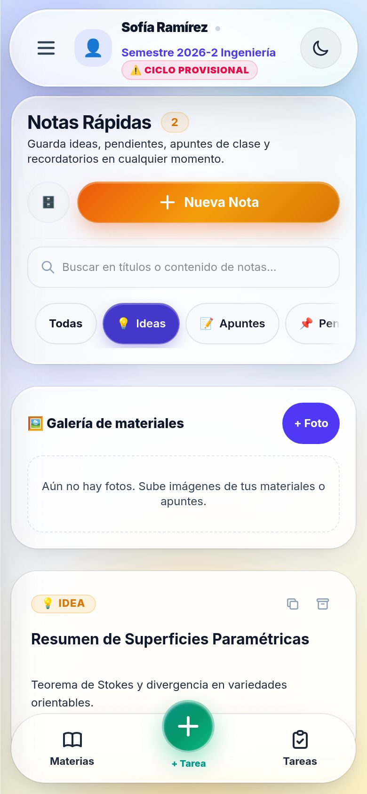

### Terminal Matrix (Experimental Automático)
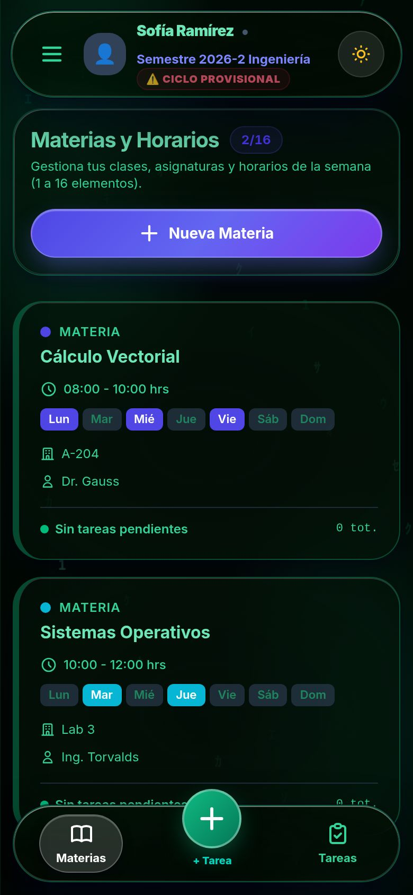

### Jardín Sakura (Experimental Automático)
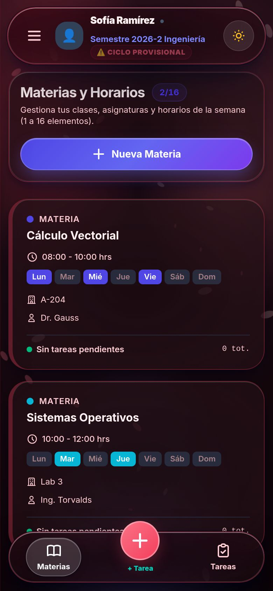

### "Mi foto" — Modo Claro
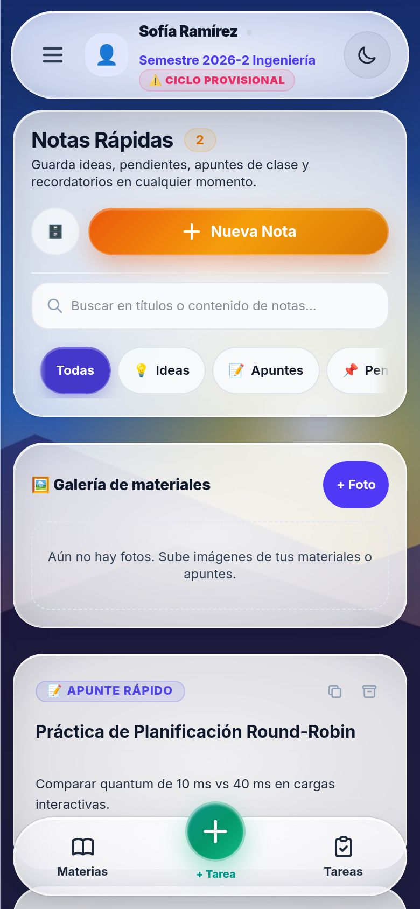

### "Mi foto" — Modo Oscuro
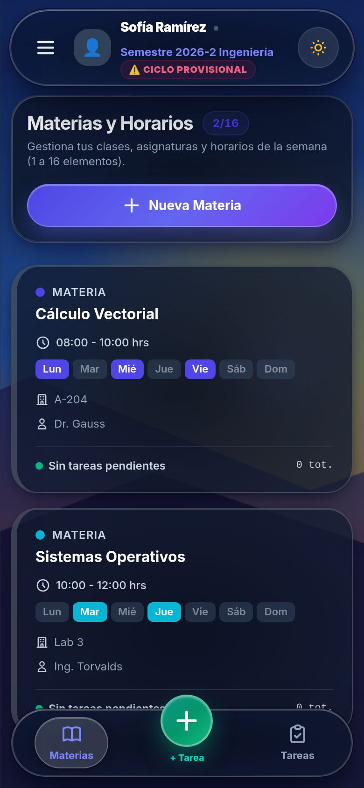

---

## Etapa 2 — Editor de Foto de Perfil (`512x512` JPEG)

### Editor en Móvil (`390px`)
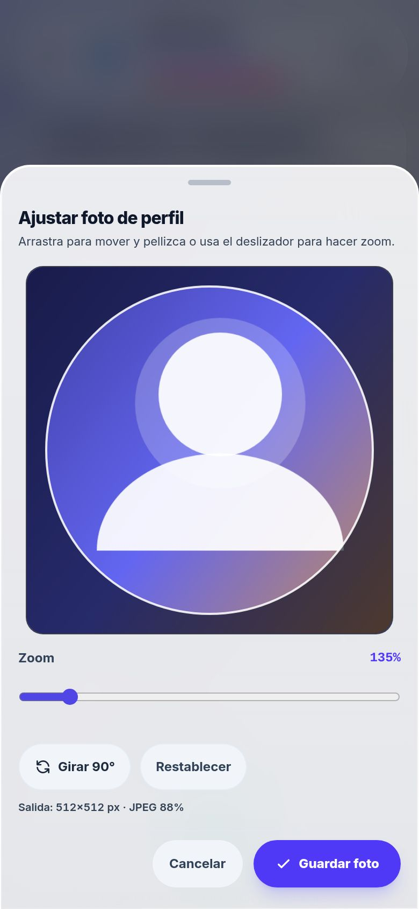

### Perfil Guardado en Configuraciones (`390px`)
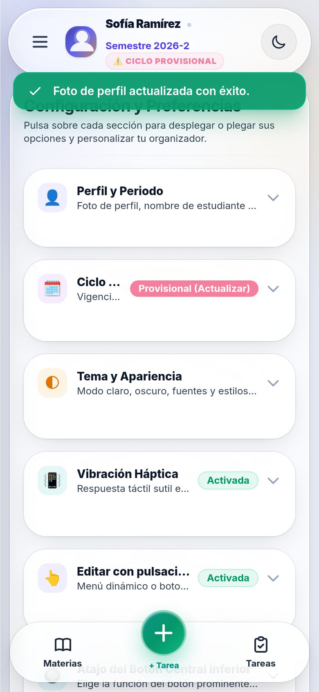

### Editor en Escritorio (`1280px`)
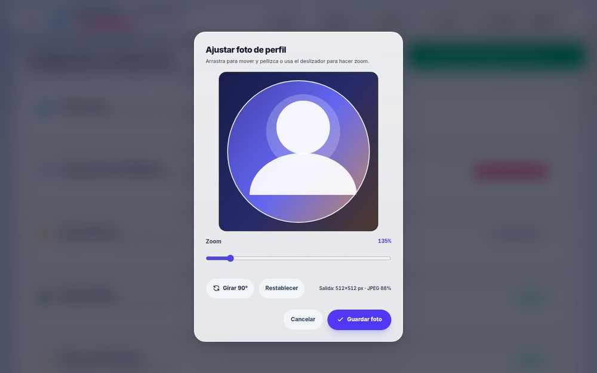

---

## Etapa 1 — Liquid Glass, Cápsulas e Interacciones

### Materias (`390px`)
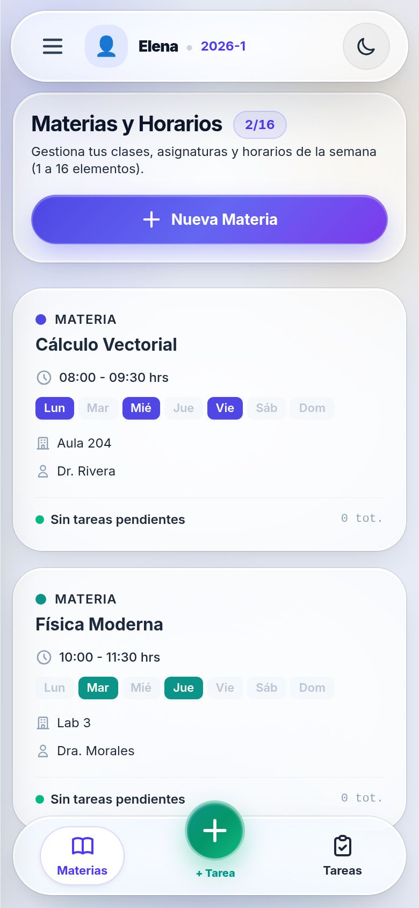

### Notas y Chips (`390px`)
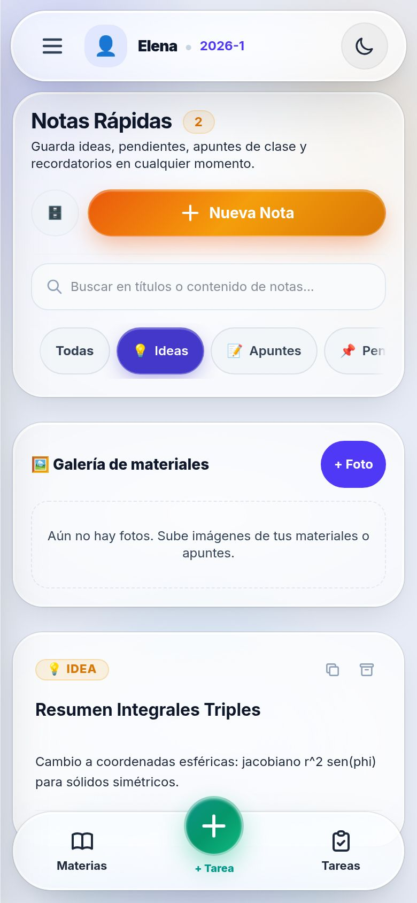

### Menú Contextual (Mantener Presionado)
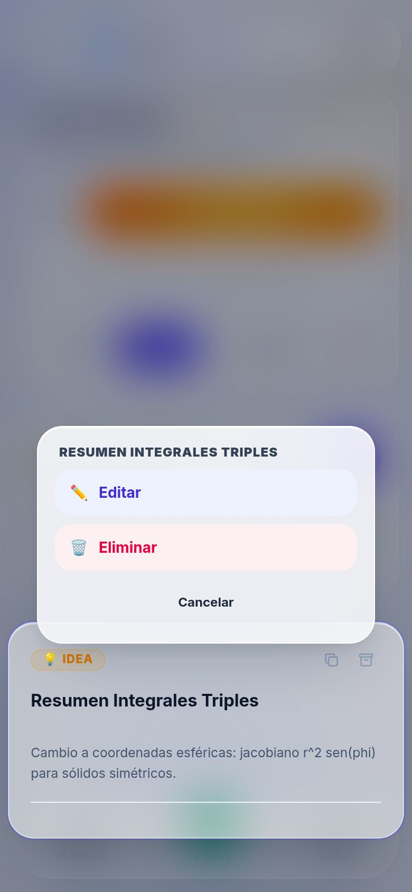

### Hoja Inferior (`90dvh`)
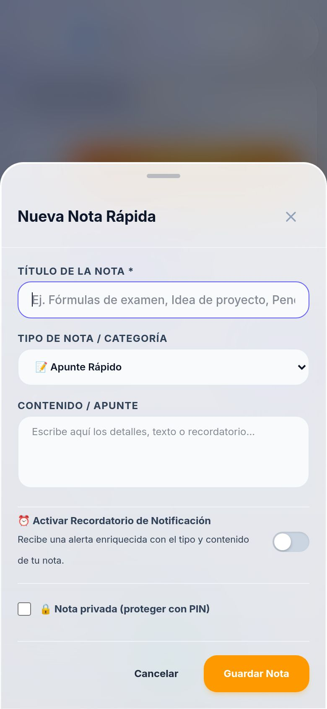

### Configuraciones Liquid Glass (`390px`)
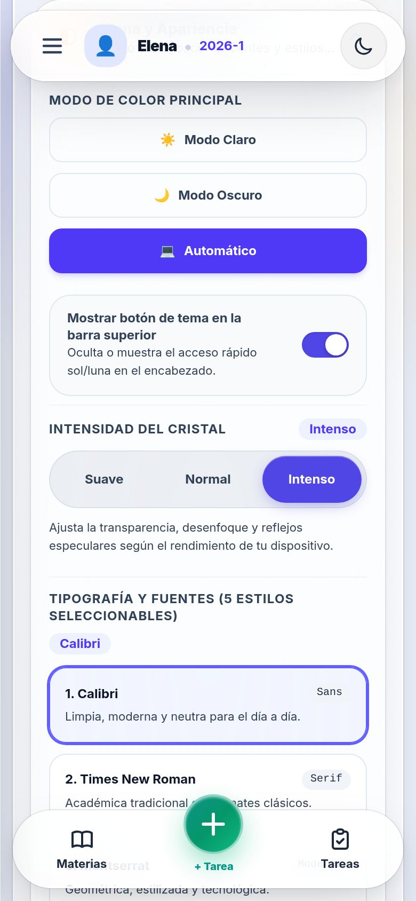

### Materias Escritorio (`1280px`)
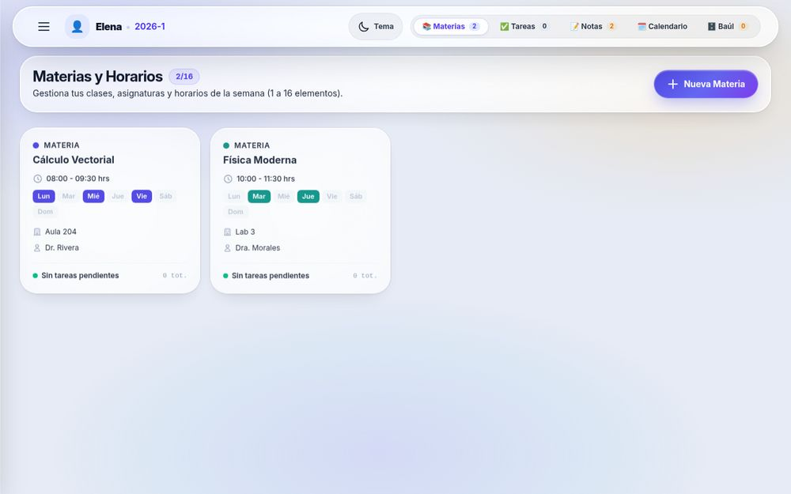
